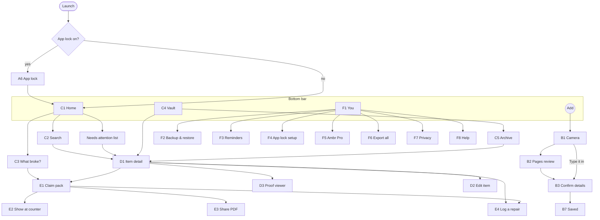
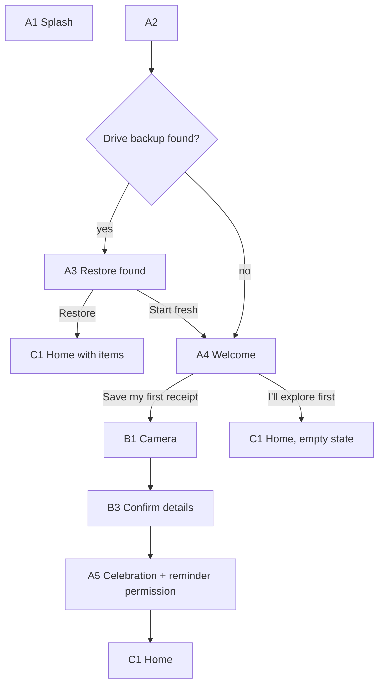
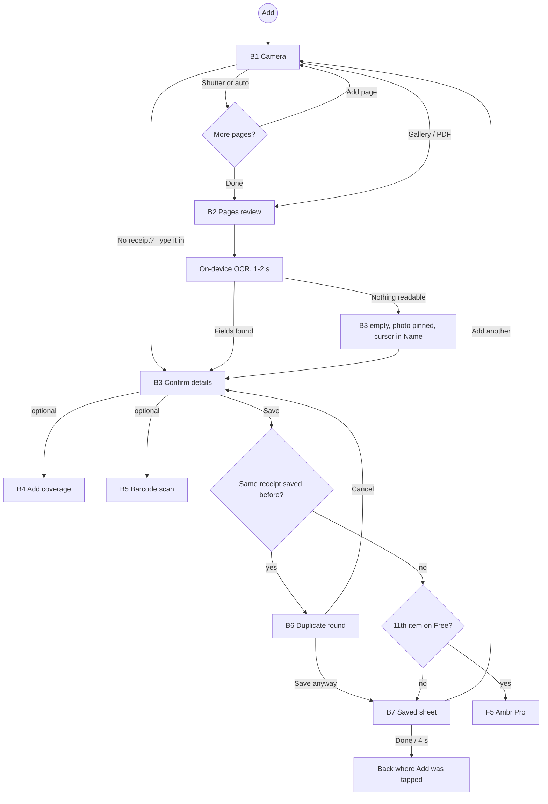
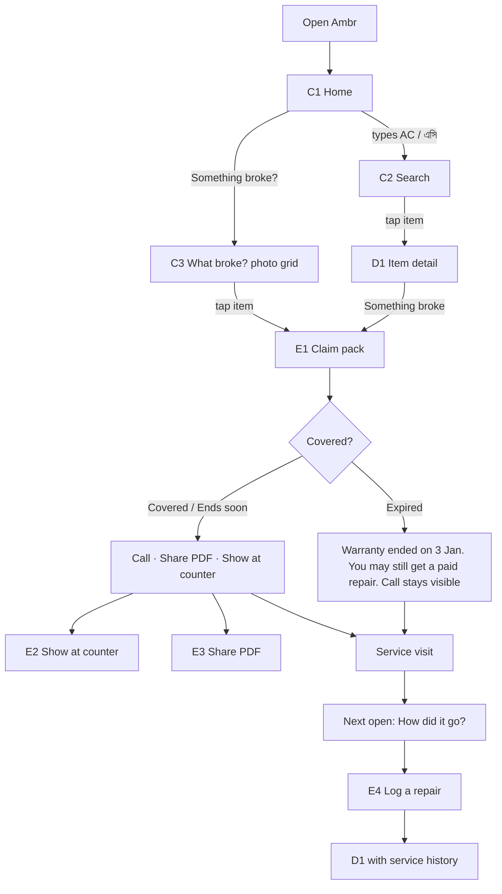
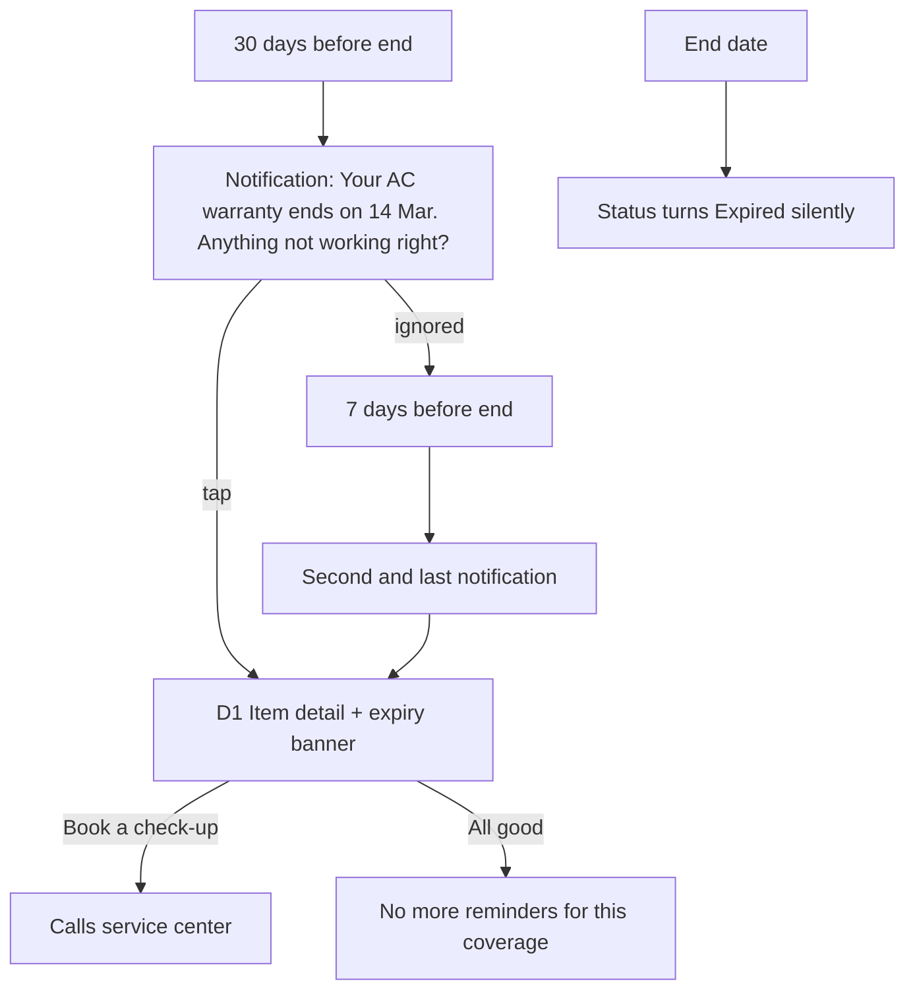
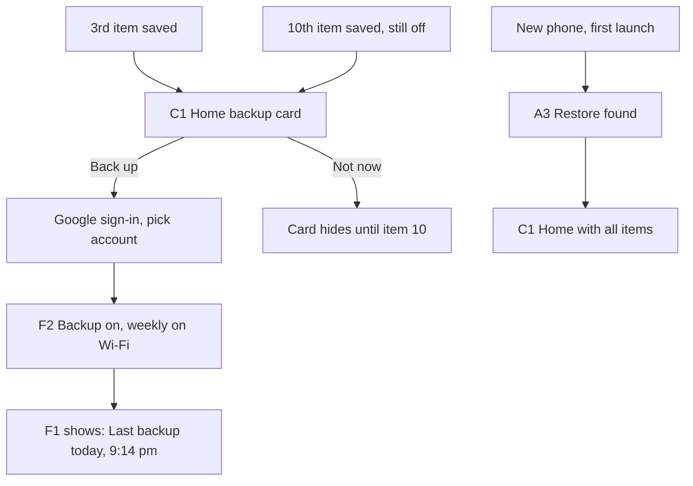
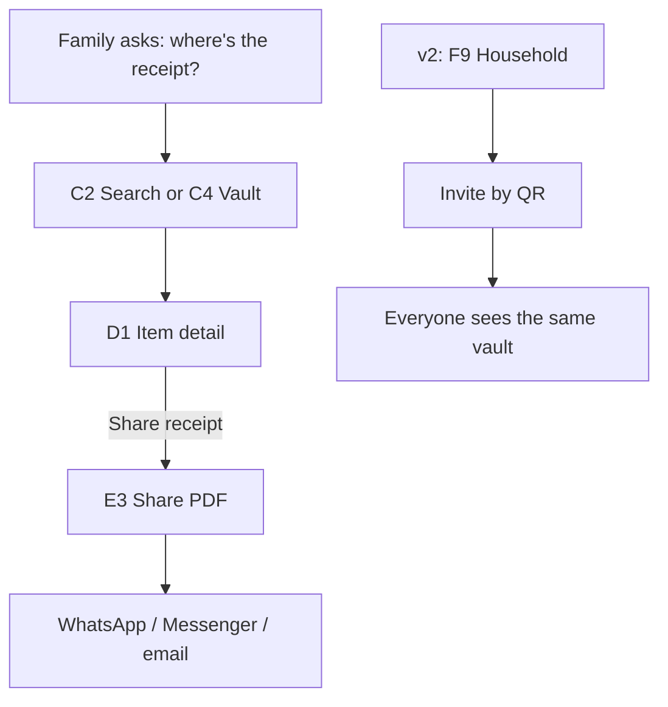
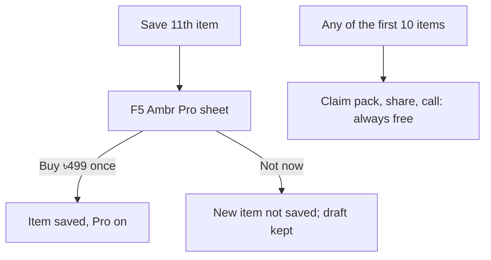

# Ambr UX Blueprint

Screens, information architecture and user flows for Ambr v1, worked out from the people who use it and the moments they use it in. Source spec: [Ambr — Product & UX Spec](https://claude.ai/artifact/7edoErE1TBBWBFKhYfXnW9).

Design direction so far: light mode only, Public Sans (English UI), amber brand. Visual style and logo to come.

## 1. Starting point: people and moments

| Person | What they bring | What the UI must do for them |
| --- | --- | --- |
| Nusrat, household keeper (primary) | Saves most items, gets blamed when proof is lost | Fast capture, one place for everything, calm reminders |
| Rafi, gadget buyer | Many small electronics, cares about resale | Serial numbers, proof for claims, sold/given-away archive |
| Abba, occasional user (62) | Rarely opens the app, only on breakdown day | Big targets, no typing needed, one plain answer: covered or not |

Ambr is used in six moments. Each screen exists to serve one of them.

| Moment | Feeling | Time budget | Screens that serve it |
| --- | --- | --- | --- |
| Buying | Excited, in a hurry at the counter | 15 s to save | Camera, Confirm, Saved |
| Quiet months | Forgets the app, and that is fine | 0 s | None. No nagging |
| Near expiry | Unaware | 1 tap | Reminder, Item detail with banner |
| Breakdown day | Panic, blame | 10 s to the answer | Home, "What broke?", Search, Item detail |
| At the service center | Stressed, standing at a counter | 1 tap to show | Claim pack, Show at counter, Share PDF |
| After the repair, or a new phone | Relief, then forgetting | 30 s | Log repair, Backup, Restore |

## 2. UX decisions that change the spec

The spec is a strong base. These changes come from looking at each moment through Abba's and Nusrat's eyes.

1. **"Something broke?" button on Home.** Search assumes the person can type and spell the item. Abba may not. A large button on Home opens a photo grid of everything owned; tap the item and the claim pack opens. Search stays for people who prefer typing.
2. **Breakdown path skips Item detail when it can.** From "Something broke?" the person lands on the claim pack directly, with the coverage answer at its top. Item detail stays the route from Vault and Search.
3. **Camera has a "Type it in" exit.** Not every purchase has a receipt to hand. The camera shows "No receipt? Type it in" so no one is stuck.
4. **Add coverage is a sheet, not a form page.** Most items have one warranty. A second one (compressor 10 years, 4 free services) is added from a bottom sheet so the main confirm screen stays short.
5. **Duplicate check happens before save, as a dialog.** One question, two answers. Never a separate screen.
6. **Restore is offered before Welcome**, only when a Drive backup is found, so a person on a new phone never re-enters 23 items by hand.
7. **Free limit never touches an existing claim.** Item 11 opens the Pro sheet; every saved item keeps its claim pack, share and call.
8. **Notification permission is asked after the first save**, not during onboarding. At that moment the reason ("we'll remind you on 22 Sep") is concrete.
9. **Archive replaces Delete as the default end of life.** "Sold or gave away" keeps the receipt for resale proof; Delete stays in the overflow with a plain warning.

## 3. Screen inventory

36 screens, sheets and dialogs. IDs are used in the flows and in code. `v1` ships at launch; `v2` comes later.

### A. Start
| ID | Screen | Type | Purpose | Release |
| --- | --- | --- | --- | --- |
| A1 | Splash | Screen | Logo while the database opens, under 1 s | v1 |
| A3 | Restore found | Screen | "Restore 23 items from your Google Drive?" Only when a backup exists | v1 |
| A4 | Welcome | Screen | One promise, one action: "Save my first receipt" | v1 |
| A5 | First save celebration | Sheet | "Your fridge is protected until Jan 2028" + reminder permission ask | v1 |
| A6 | App lock | Screen | Fingerprint or PIN gate, only if turned on | v1 (Pro) |

### B. Capture
| ID | Screen | Type | Purpose | Release |
| --- | --- | --- | --- | --- |
| B1 | Camera | Screen | Edge-detected capture, auto shutter, gallery/PDF import, "Type it in" | v1 |
| B2 | Pages review | Screen | Crop, reorder or retake pages before OCR | v1 |
| B3 | Confirm details | Screen | Pre-filled fields, "Check this" on unsure ones, sticky Save | v1 |
| B4 | Add coverage | Sheet | Second warranty: type, length, starts from, parts or free-service count | v1 |
| B5 | Barcode scan | Screen | Scan serial number into B3 | v1 |
| B6 | Duplicate found | Dialog | "Looks like you already saved this receipt on 2 Jun. Save anyway?" | v1 |
| B7 | Saved | Sheet | "Fridge saved. Covered until 22 Oct 2027." Add another / Done | v1 |

### C. Find
| ID | Screen | Type | Purpose | Release |
| --- | --- | --- | --- | --- |
| C1 | Home | Tab | Is anything at risk? Search, "Something broke?", needs attention, protected total | v1 |
| C2 | Search | Screen | Results with status pills; "Not saved yet? Add it" when empty | v1 |
| C3 | What broke? | Screen | Big photo grid of items, tap one to open its claim pack | v1 |
| C4 | Vault | Tab | Everything owned, by room or category, filters and sort | v1 |
| C5 | Archive | Screen | Sold and given-away items, receipts kept | v1 |

### D. Item
| ID | Screen | Type | Purpose | Release |
| --- | --- | --- | --- | --- |
| D1 | Item detail | Screen | Status sentence first, then "Something broke", proof, coverage, details, service history | v1 |
| D2 | Edit item | Screen | Same fields as B3, opened from D1 | v1 |
| D3 | Proof viewer | Screen | Full-screen receipt and card pages, pinch zoom, add page | v1 |
| D4 | Mark as sold | Dialog | Move to Archive with date, keep receipt | v1 |
| D5 | Delete | Dialog | "Delete Fridge and its receipt? You can't undo this." | v1 |

### E. Claim
| ID | Screen | Type | Purpose | Release |
| --- | --- | --- | --- | --- |
| E1 | Claim pack | Screen | Status, receipt, card, serial in large type, store, dates, Call service center | v1 |
| E2 | Show at counter | Screen | Full screen, max brightness, receipt + serial, swipe pages | v1 |
| E3 | Share PDF | Sheet | Preview of the one-page PDF, then Android share (WhatsApp, Messenger, email) | v1 |
| E4 | Log a repair | Screen | Date, what went wrong, outcome, cost, photo | v1 |

### F. You
| ID | Screen | Type | Purpose | Release |
| --- | --- | --- | --- | --- |
| F1 | You | Tab | Backup status on top, then settings list | v1 |
| F2 | Backup & restore | Screen | Google Drive sign-in, Back up now, last backup time, Restore | v1 |
| F3 | Reminders | Screen | Lead time (7/14/30/60 days), quiet hours | v1 |
| F4 | App lock setup | Screen | Turn on fingerprint or PIN | v1 (Pro) |
| F5 | Ambr Pro | Sheet | One-time ৳499; what you get; never locks old items | v1 |
| F6 | Export all | Screen | PDF or CSV of every item | v1 (Pro) |
| F7 | Privacy | Screen | Plain-words promise: data stays on this phone | v1 |
| F8 | Help & feedback | Screen | Short FAQ and a feedback form | v1 |
| F9 | Household | Screen | Invite by QR, members, "Added by" | v2 |

System surfaces: expiry notification (30 and 7 days), home-screen "Ending soon" widget (v2).

## 4. Information architecture

Three tabs and one Add button. Every breakdown-day answer is at most two taps from launch.

### What each tab answers

| Tab | Question | Contents, top to bottom |
| --- | --- | --- |
| Home | "Is anything at risk? Where is X?" | Search bar · "Something broke?" button · Needs attention (≤ 30 days) or "All good" · Protected total (18 items · ৳4,85,000) · Recently added · Backup card when off |
| Vault | "Show me everything I own" | By room / By category toggle · Filters: All, Covered, Ends soon, Expired · Item grid · Archive link |
| You | "Is my data safe?" | Backup status · Reminders · App lock · Ambr Pro · Privacy · Export · Help |

### Content model

| Object | Key fields | Notes |
| --- | --- | --- |
| Item | name*, category, room, brand, model, serial, price, purchase date, store, photo, status (active, archived) | Only name is required |
| Proof | item, kind (receipt, card, invoice), pages[], OCR text | Many per item; OCR text indexed for search |
| Coverage | item, type (manufacturer, shop, extended, free services), starts from (purchase, delivery, custom), start, end, scope (parts, service, both), services used / total | Many per item; status uses the longest active one |
| Service contact | brand, center name, phone, address | Pre-filled for known brands |
| Repair | item, date, problem, outcome, cost, notes, photo | Builds service history |
| Reminder | coverage, fire date, kind (30 d, 7 d), state (pending, sent, dismissed) | Max 2 per coverage |

Status rule: **Covered** when the longest active coverage ends in more than 30 days, **Ends soon** within 30 days, **Expired** when none is active, **No proof yet** shown as a note, never as a status.

## 5. User flows

### Flow 1: First launch (target: first item saved in under 60 s)

Rules: no account, no email. Camera permission is asked only when the camera opens. Notification permission is asked on A5, with the real reminder date in the sentence.

### Flow 2: Add an item (target: under 15 s)

Short path: Add → shutter → Done → Save → Done. Five taps.

### Flow 3: Breakdown day (target: answer in under 10 s)

### Flow 4: Expiry reminder

Max 2 notifications per coverage, ever. Lead time is changeable in F3.

### Flow 5: Backup and restore

### Flow 6: Share with family

### Flow 7: Free limit and Pro

## 6. Screen states every screen must design

| State | Rule | Example copy |
| --- | --- | --- |
| Empty | Say what goes here and offer the first action | "Nothing saved yet. Start with the most expensive thing you own." |
| All clear | Reassure, never an empty list | "All good. Nothing ending soon." |
| Loading | Shimmer on the exact fields being filled | OCR shimmer on Name, Store, Price, Date |
| Unsure | Amber underline + words, never blocks | "Check this" |
| Error | What happened + what to do, no error codes | "Couldn't read this one. Just type the name, the photo is saved." |
| Permission denied | Explain + way forward | "Camera is off for Ambr. Open settings, or add without a photo." |
| Expired | Kind, with a next step | "Warranty ended on 3 Jan. You may still get a paid repair." |

## 7. Design rules carried into the visual design

- Light mode only. Status pills always pair color with a word and an icon: Covered, Ends soon, Expired.
- Type: Public Sans. Body 16 sp minimum; status sentence on D1 and E1 at 24 sp or larger. Layouts reflow at 200% font scale.
- Tap targets at least 48 × 48 dp; primary actions full width at the bottom, within thumb reach.
- Dates as "14 Mar 2027". Money as ৳ with South Asian grouping (৳4,85,000).
- Amber on white only for large text or with a dark outline (WCAG AA).
- One primary action per screen.
